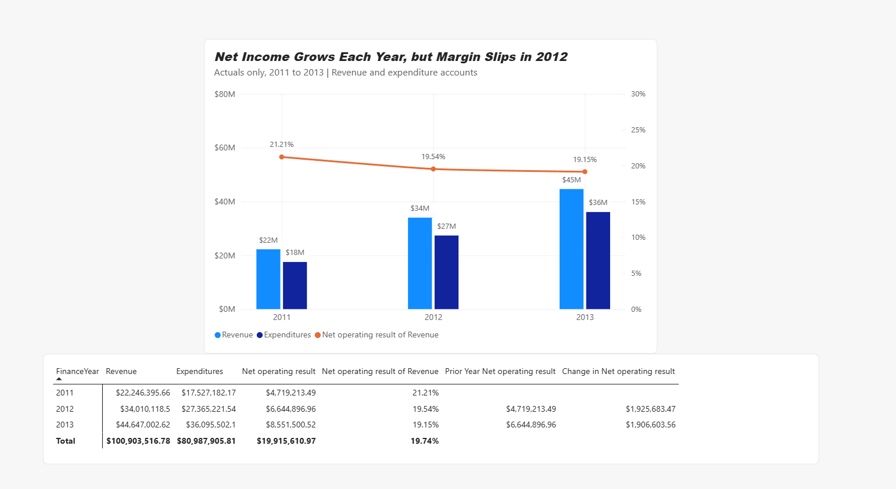
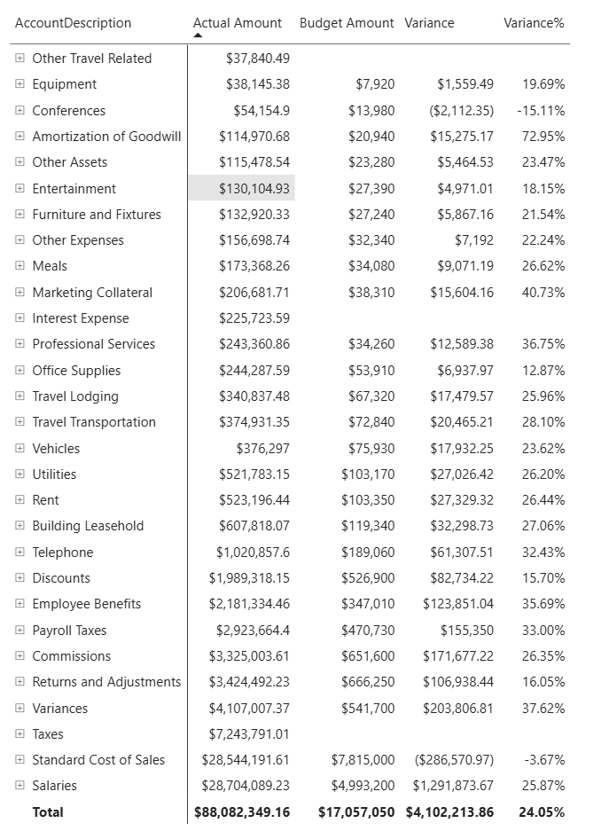
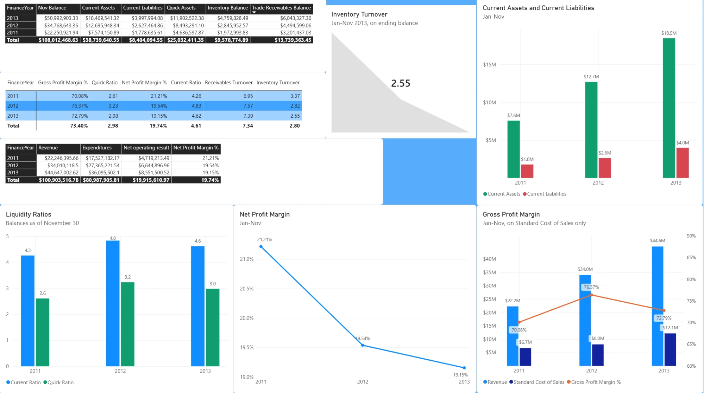

# FP&A variance and forecast (AdventureWorks)

A budget-versus-actual dashboard and a backtested forecast, built in SQL Server and Power BI on Microsoft's AdventureWorksDW sample data. It also covers the errors I found in my own work. Case study: [analysttom712.github.io/projects/fpa-variance.html](https://analysttom712.github.io/projects/fpa-variance.html).

## The five business questions

1. **Variance:** How does actual spending compare to budget by account, and which accounts vary most?
2. **Trend:** How have revenue and expenditures moved year over year, and is the gap widening?
3. **Mix:** Which account types take the largest share, and has the mix shifted?
4. **Consistency and health:** Which results hold year after year, and what do the balance sheet ratios say?
5. **Forecastability:** Which accounts follow a predictable pattern, and which are too volatile to forecast?

## Data

The data is AdventureWorksDW, Microsoft's free sample for a fictional bike manufacturer, restored in SQL Server. It has actuals by account for 2010 to 2013, but budgets only for 2010 and 2011. The database backup is not in this repo. Download it from [Microsoft](https://learn.microsoft.com/en-us/sql/samples/adventureworks-install-configure) and restore it in SQL Server Management Studio.

## What's here

| Path | What it is |
|---|---|
| `BI_Project_FPA_2026.pbix` | The original Power BI report and model, as one file |
| `pbip/` | The same project as a Power BI Project (PBIP): the model in TMDL and the report pages in JSON, so every table, measure and visual is readable and diffable. It adds the five "Deeper" pages |
| `dax/fpa-measures.dax` | All 35 DAX measures, exported from the model. Paste into DAX query view and run. |
| `sql/` | SQL Server queries: the two I ran in SSMS to check the shape of `FactFinance` and `DimAccount`, and the source query behind the model's `Query` table |
| `images/` | Report screenshots |
| `deeper-model/` | A whole-database analysis: what the original model missed, the SQL views and DAX behind the Deeper pages, and a checklist of what to verify and where |

## What I caught

- **Wrong period count.** The first result showed accounts 265% to 658% over budget. Four years of actuals were being compared with two years of budget. The fix is a measure that counts actuals only in budgeted years. `Original Variance` and `Variance` stay side by side on purpose so the difference is visible.
- **A blank read as zero.** It produced a false $5.46M swing until an `ISBLANK` check fixed it.
- **Four data-shape problems:**
  - a year with only one month of data
  - a missing December
  - balance sheet accounts that are snapshots, not activity
  - rollup accounts that are all zero

  On a like-for-like January to November basis, net operating margin fell from 21.2% to 19.2%.

## Results

The forecast predicts 2013 as 2012 plus the prior year's change. In the backtest it came within 3.1% in total but missed many individual accounts. That is one test point per account, and a lesson that a total can hide detail.

## What the business should do

These fixes are based on the full-database analysis in [deeper-model/](deeper-model/README.md). That analysis converts every amount to USD, nets returns out of sales, removes intercompany sales and puts each posting in its true month. On that basis, operating margin fell from 26.4% to 22.0% between 2011 and 2013 (January to November each year). The fixes are listed by how much margin they affect.

1. **Hold operating expense growth to sales growth.** From 2011 to 2013, net sales grew 69% but operating expenses grew 95%, from $8.25M to $16.12M. Gross margin went up (65.4% to 67.2%), so the problem is spending, not product margin. Set each department's expense budget as a percentage of sales, and review it every quarter.
2. **Find out why pay per person is rising.** Labor doubled, from $6.37M to $12.74M, while headcount grew only 49%, from 184 to 274. Split the increase into hiring, raises and mix before approving the next hiring plan. Executive General and Administration (+153%) and R&D (+99%) grew fastest.
3. **Turn around or rethink the weakest organizations.** In 2013, Southeast Division lost money (-8.0% operating margin, -$202,557). Northeast (1.5%) and Australia (5.0%) barely broke even, while Southwest earned 36.1% on similar products. Compare their pricing, discounts and cost per head with Southwest's.
4. **Budget every year and every account.** The only budget is for 2011, on 28 of the 71 accounts that have actuals. On that budget, revenue came in 9.7% under plan. Without a 2012 or 2013 budget, nobody could see the cost growth against a plan as it happened.
5. **Report in one currency, with intercompany removed.** Four organizations post in CAD, EUR or AUD, and the original totals add them together unconverted. Intercompany sales ($1.9M in 2013) sit inside revenue, and intercompany receivables and payables don't offset. Set consolidation rules, including how to treat the 25% to 75% owned divisions.
6. **Close on a fixed calendar.** Posting dates drift (February 2011 posted on March 1), and December 2013 has only year-end entries. A fixed period calendar stops reports from putting a month in the wrong place or leaving one out.
7. **Forecast by line, with drivers.** The backtest came within 3.1% in total but missed many accounts. Forecast labor from headcount and cost per head, and sales by organization, so a miss shows which line and why.

## How to open

1. Restore AdventureWorksDW in SQL Server.
2. For the Deeper pages, run `deeper-model/sql/10_model_views.sql` in SSMS (it creates schema `fpa` and adds no data).
3. Open `pbip/BI_Project_FPA_2026.pbip` (all pages) or `BI_Project_FPA_2026.pbix` (original pages) in Power BI Desktop.
4. If the server name differs from mine (`localhost\SQLEXPRESS`), go to Transform data > Data source settings, point it at your SQL Server, then refresh.

## Write-ups

- [From Benefits to Business Questions: I Built an FP&A Variance Dashboard from Scratch](https://www.linkedin.com/pulse/budget-vs-actual-what-i-learned-building-fpa-dashboard-thomas-baynum-ldywe)
- [The Gap Between Revenue and Expenses. What the Data Said](https://www.linkedin.com/pulse/gap-between-revenue-expenses-what-data-said-thomas-baynum-cp2be)
- [I Almost Posted the Wrong Numbers: What a Power BI Project Taught Me About Trusting Data](https://www.linkedin.com/pulse/i-almost-posted-wrong-numbers-what-power-bi-project-taught-baynum-ewhke)

## Credits

I chose the questions, checked the shape of the data, and tested and corrected every result.

Who wrote what:

| Code | Written by |
|---|---|
| `sql/` (all three queries) | Me |
| `dax/fpa-measures.dax` (35 measures) | Me and Claude (AI) together. There is no per-measure record of who wrote which. I tested and corrected every measure |
| `deeper-model/` (SQL, DAX and the five Deeper pages) | Claude (AI) at my direction. I checked the results against SQL Server |

Each file also says who wrote it in its first lines.

Tools: SQL Server (SSMS), Power BI, DAX.
