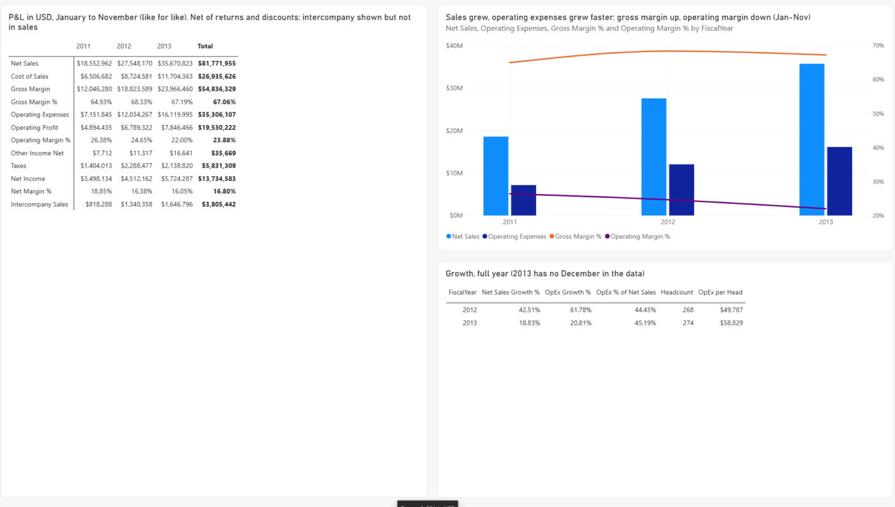
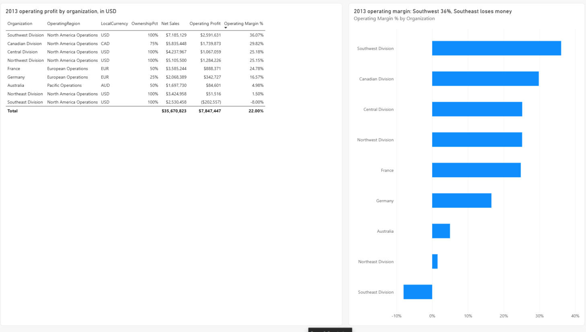
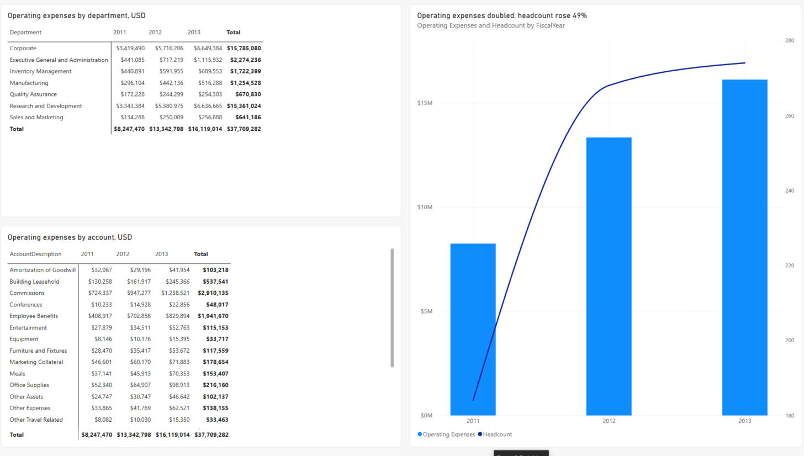
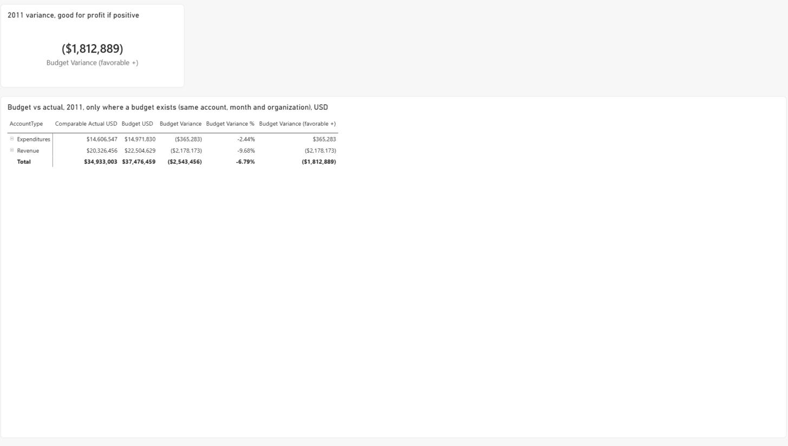
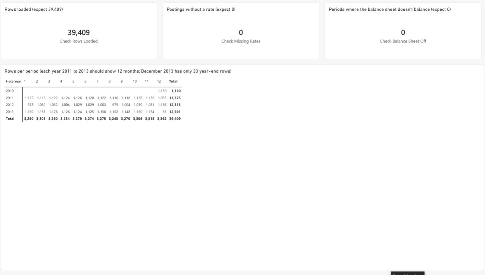

# A deeper model: analyzing the whole database first

The original dashboard reads one grouped query, `FactFinance` joined to `DimAccount` and `DimScenario`. This folder shows what changes when you profile the **whole** AdventureWorksDW database before modeling. The profiling turned up problems that change the answers. It also led to a rebuilt model that fixes them, now in the Power BI project, and to a checklist of what to verify and where to look.

The analysis was done by Claude (AI) at my direction. Every query ran against my local SQL Server copy of AdventureWorksDW2025, and the numbers below come from those runs. The views in `sql/10_model_views.sql` are created in schema `fpa` and add no data. The model is built in [`../pbip/`](../pbip/) as five pages named "Deeper 1" to "Deeper 5". `measures.dax` is exported from that model. Its results were checked against SQL Server and match to the dollar (see the checklist at the end).

## How the database was analyzed

| Step | Question | Script |
|---|---|---|
| 1. Inventory | What tables are there, how big are they, and how do the account, organization and department trees fit together? | `sql/01_inventory_and_hierarchies.sql` |
| 2. Test assumptions | Is every amount in dollars? Is every month there? Does any level double count? Which accounts aren't money? | `sql/02_dates_currency_scope.sql` |
| 3. Explain the oddities | Why do months repeat or go missing? Which profit lines are added and which are subtracted? | `sql/03_posting_dates_and_signs.sql` |
| 4. Rebuild the answer | What is the P&L in one currency, net of returns, with intercompany taken out? How far is it from what the dashboard shows? | `sql/04_corrected_pnl.sql` |
| 5. Find the drivers | What is pulling the margin down, and how did 2011 do against budget on a like-for-like basis? | `sql/05_cost_drivers_and_budget.sql` |
| 6. Build the model | Five views that fix what steps 2 and 3 found | `sql/10_model_views.sql` |

## What the database has that the dashboard doesn't use

| In the database | Used now? | Why it matters |
|---|---|---|
| `DimOrganization`: 9 posting organizations under North America, European and Pacific Operations, each with a currency and an ownership % | No | Profit by organization, and the currency each amount is in |
| `DimDepartmentGroup`: 7 departments | No | Where operating expenses go |
| `DimAccount` tree, `Operator` (+ or -) and `ValueType` (currency or units) | Type only | The correct P&L lines and signs. Separates headcount and square footage from money |
| `FactCurrencyRate`: a daily average rate per currency | No | Turns CAD, EUR and AUD into USD |
| Statistical accounts: Headcount, Units, Square Footage | No | Cost per head, a driver for the forecast |
| `FactResellerSales`, `FactInternetSales`, `FactSalesQuota` | No | Sales by product and territory, and sales against quota (once they're reconciled to finance, see finding 10) |

## What the analysis found

| # | Finding | Evidence | Effect on the current dashboard |
|---|---|---|---|
| 1 | **Amounts are in four currencies.** Canada posts in CAD, France and Germany in EUR, Australia in AUD. | Step 2: 2013 Trade Sales for Canada are 9,549,370, but USD is only 5,835,448 after conversion and returns. Every posting has a matching rate (0 missing). | Totals add CAD, EUR and AUD to USD as if they were the same unit |
| 2 | **Posting dates drift into the next month.** February 2011 posts on Mar 1, April on May 1, June on Jul 1 and July on Aug 1. | Step 3: `MONTH(Date)` gives 2011 no February, April or June, and two March, May and August postings | Monthly views and the "November balance" ratios pick up the wrong period in 2011. Fix: move each date back 3 days, which gives exactly 12 periods a year |
| 3 | **December 2013 is missing.** It has only 33 year-end rows (goodwill amortization, FX, other income and equity), against about 1,150 in every other month. | Step 3 and the view test | Full-year 2013 is really January to November. The original write-up's "missing December" is this |
| 4 | **Returns and discounts are counted as costs.** In the account tree they are contra-revenue, under Net Sales. | `Operator` is "-" under Net Sales. 2013: 1,190,730 returns and 482,349 discounts | Revenue is gross, not net, so every margin % has the wrong denominator |
| 5 | **Intercompany sales are in revenue.** | 2013: 1,901,825 intercompany sales. Intercompany receivables (13.4M) and payables (4.7M) don't offset | Revenue includes sales from one part of the company to another |
| 6 | **"Net operating result" is really net income.** | It includes interest, other income and taxes | The label overstates what it measures. Operating profit stops before those lines |
| 7 | **Corporate is its own department, not a total.** | Step 3: Corporate salaries ($275,727, Southeast 2013) aren't the sum of the other departments | Safe to add departments together (checked, no double count) |
| 8 | **The budget is thin.** | Budgets exist only for December 2010 and January to November 2011, on 28 of the 71 accounts that have actuals | Budget vs actual can only cover 2011 and those accounts |
| 9 | **Ownership isn't 100% everywhere.** | Canada 75%, France 50%, Germany 25%, Australia 50% | A consolidation decision: full consolidation with a minority interest, or proportional |
| 10 | **Finance sales don't tie to the sales tables.** | 2013: finance Trade Sales 42.6M (mixed currencies) against reseller 33.6M plus internet 16.4M | Don't put a sales-detail page next to the P&L until these are reconciled |

## The corrected answer

January to November of each year, so the years compare like for like. Figures are in USD, net of returns and discounts, without intercompany, and use the true posting period. Source: step 4 and the view test.

| | 2011 | 2012 | 2013 |
|---|---|---|---|
| Net sales (USD) | $18,552,962 | $27,548,170 | $35,670,823 |
| Original dashboard margin (local currencies mixed, gross revenue) | 21.21% | 19.54% | 19.15% |
| **Operating margin** | **26.38%** | **24.65%** | **22.00%** |
| **Net margin** | **18.85%** | **16.38%** | **16.05%** |

The original direction holds: margin is falling. But the corrected view shows where the fall comes from. Gross margin went up, from 65.4% in 2011 to 67.2% in 2013 (full year, USD), so products aren't the problem. **Operating expenses are.**

- Net sales grew 69% from 2011 to 2013. Operating expenses grew 95%, from $8.25M to $16.12M (USD, 2013 without December on both sides).
- Labor doubled, from $6.37M to $12.74M, while headcount grew 49%, from 184 to 274. So cost per head rose too.
- By department, Executive General and Administration grew 153%, R&D 98.5% and Corporate 94.5%.
- By organization in 2013, Southwest earns a 36.1% operating margin. Southeast loses money (-8.0%, -$202,557). Northeast (1.5%) and Australia (5.0%) barely break even.
- Against budget in 2011, on budgeted accounts and months only, revenue came in 9.7% under ($20.33M against $22.50M) and expenses 2.4% under.

## The model

Five views (`sql/10_model_views.sql`) replace the single grouped query:

- **FactFinance:** one row per posting with the true period, the local amount, the USD amount, and a flag if a rate is missing
- **DimAccount:** the account tree, the path, the statement line and a profit sign (+1, -1 or 0)
- **DimPeriod:** fiscal year, fiscal month and a label
- **DimOrganization:** organization, parent, operating region, ownership % and currency
- **DimDepartment:** department name

The five pages in the Power BI project:

| Page | Shows |
|---|---|
| Deeper 1: P&L in USD | Net sales down to net income, January to November each year; sales against operating expenses; growth |
| Deeper 2: Organizations | 2013 operating margin by organization, with currency and ownership % |
| Deeper 3: Cost drivers | Operating expenses by department and by account; expenses against headcount |
| Deeper 4: Budget vs actual 2011 | Only cells where a budget exists, with a favorable/unfavorable sign |
| Deeper 5: Data checks | Rows loaded, missing rates, balance sheet check, rows per period |

To rebuild it on your machine:
1. Restore AdventureWorksDW2025 and run `sql/10_model_views.sql` in SSMS. It creates schema `fpa` and adds no data.
2. Open `pbip/BI_Project_FPA_2026.pbip` in Power BI Desktop. If your server isn't `localhost\SQLEXPRESS`, change it under Transform data > Data source settings.
3. Refresh, then check the Deeper 5 page before reading the others.

Not built yet: a waterfall P&L, and a balance sheet and ratios page in USD.
## What you should check, and where

| # | Check | Expected | Where to look |
|---|---|---|---|
| 1 | Every posting loaded | 39,409 rows | Power BI: Checks page, **Check Rows Loaded**. SSMS: `SELECT COUNT(*) FROM dbo.FactFinance` |
| 2 | Every non-USD posting has a rate | 0 | Checks page, **Check Missing Rates** |
| 3 | Rate direction is right: the rate is USD per one unit of local currency, so we multiply | CAD about 0.65 and AUD about 0.55 (one CAD buys less than a dollar) | SSMS: the rate query in `02_dates_currency_scope.sql`. If a rate is above 1 for CAD, the direction is reversed: divide instead |
| 4 | Each year has 12 periods after the date fix | 2011, 2012 and 2013 each show months 1 to 12 | Power BI: a matrix of DimPeriod[FiscalYear] by [FiscalMonth] with Check Rows Loaded. SSMS: `SELECT * FROM fpa.DimPeriod` |
| 5 | December 2013 is year-end entries only | 33 rows | Same matrix: December 2013. Leave December out of year-over-year comparisons |
| 6 | Balance sheet balances every period | 0 periods off | Checks page, **Check Balance Sheet Off** |
| 7 | The model matches the SQL | Jan to Nov net margin 18.85%, 16.38%, 16.05% | P&L page, filtered to months 1 to 11, against step 4 |
| 8 | Corporate isn't a total of the others | Corporate differs from the sum of the other departments | SSMS: `03_posting_dates_and_signs.sql`, Corporate vs children |
| 9 | Ownership treatment | Your decision | DimOrganization[OwnershipPct]. Write down which method the report uses |
| 10 | Intercompany | Sales eliminated. Receivables and payables don't offset (13.4M vs 4.7M) | Step 2 intercompany query. Decide whether to show balances gross |
| 11 | Budget coverage | 28 accounts, Dec 2010 and Jan to Nov 2011 | Budget page: Comparable Actual USD is blank wherever no budget exists |
| 12 | Sales tables vs finance | They don't tie yet | Step 2, last query. Reconcile before adding a sales page |

If any check fails, fix it before reading the pages. The pages are only as right as the checks.
